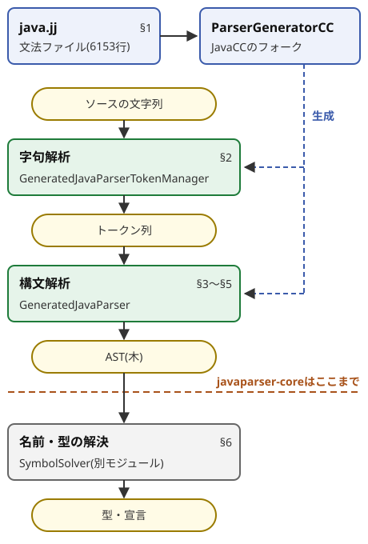

# JavaParserは、Javaのソースをどうやって木にしているのか

> **想定読者**: Haskell(AtCoder)とJava(業務)を書き、構文解析の理論はほぼ初めての人。Visitorパターンは知っている
> **省いたもの**: JavaParserのAPI一覧と導入手順、LR構文解析の詳細、構文エラーからの回復
> **所要時間**: 約20分。JavaParserを業務で使えるかだけ知りたいなら、§6と§7で足りる(約5分)
> **検証方法**: JavaParser 3.28.2(Maven Central)と、同じタグの文法ファイル`java.jj`で実行・照合した。HaskellはGHC 9.8.4。引用はすべて`verify-doc.mjs`で実物と照合した

---

## 0. 一枚で

| 問い | 答え | 節 |
|---|---|---|
| パーサは手書きか | 手書きではない。文法ファイル`java.jj`から、ParserGeneratorCC(JavaCCのフォーク)がJavaのコードを生成する | 1 |
| 文字列から直接、木を作るのか | 2段階。字句解析で単語(トークン)に切り、その列を構文解析する | 2 |
| 構文解析はどういう仕組みか | 再帰下降。文法の規則1つがメソッド1つになり、次のトークンを見て分岐する | 3 |
| 言語仕様(JLS)の文法をそのまま使えるか | 使えない。左再帰の規則は止まらないので、繰り返し`( … )*`に書き換えてある | 4 |
| 1トークン見ても決まらないときは | 候補の規則で最後まで試し読みしてから決める。先読みの長さに上限がない | 5 |
| パースが通れば型も正しいか | **保証しない**。型の誤りはパースを通る。型を知るにはSymbolSolverが要る | 6 |



青の点線がビルド時、緑が実行時の処理。
javaparser-coreが作るのはAST(抽象構文木)まで。

---

## 1. パーサは文法ファイルから生成されている

文法は「規則」の集まりで、BNFという記法で書く。
四則演算なら3つの規則で足りる。

<!-- source: examples/haskell/Calc.hs -->
```haskell
--   expr   ::= term   (("+" | "-") term)*
--   term   ::= factor (("*" | "/") factor)*
--   factor ::= 数 | "(" expr ")"
```

`::=`は「左の名前は、右の並びのこと」と読む。
`|`は「どれか1つ」、`( … )*`は「0回以上の繰り返し」、`"+"`はその記号そのもの。

JavaParserは、Javaの文法を`java.jj`というファイルに同じ形で書いている。
足し算の規則はこうなっている。

<!-- source: ref/java.jj -->
```
Expression AdditiveExpression():
{
    Expression ret;
    Expression right;
    BinaryExpr.Operator op;
}
{
    ret = MultiplicativeExpression()
    (
        (
            "+" { op = BinaryExpr.Operator.PLUS; }
         |
            "-" { op = BinaryExpr.Operator.MINUS; }
        )
        right = MultiplicativeExpression()
        { ret = new BinaryExpr(range(ret, token()), ret, right, op); }
    )*
    { return ret; }
}
```

上の`expr ::= term (("+" | "-") term)*`と同じ形をしている。
違いは、`{ … }`に「読めたときに実行するJavaのコード」が埋め込まれていること。
ここで木の節点(`BinaryExpr`)を作る。

ビルド時に、ParserGeneratorCCがこのファイルを`GeneratedJavaParser.java`に変換する。
生成されたファイルの2行目にそう書いてある。

<!-- source: ref/src/com/github/javaparser/GeneratedJavaParser.java -->
```java
/* Generated by: ParserGeneratorCC: Do not edit this line. GeneratedJavaParser.java */
```

ParserGeneratorCCは、JavaCC 7.0.3のフォーク([README](https://github.com/phax/ParserGeneratorCC))。
以降「JavaCCの仕様」として引くものは、JavaCCの公式文書による。

**JavaParserを理解するとは、`java.jj`の文法と、それを実行するしくみ(§3〜§5)を理解すること。**

---

## 2. 字句解析: まず単語に切る

字句解析は、文字の列をトークン(識別子・記号・リテラルなど、意味を持つ最小の単語)の列にする段階。
空白とコメントはここで脇によける。

`List<List<String>> a = b >> 1;`を字句解析した結果がこれ。

<!-- output: tokens -->
```
List   IDENTIFIER
<      LT
List   IDENTIFIER
<      LT
String IDENTIFIER
>      GT
>      GT
a      IDENTIFIER
=      ASSIGN
b      IDENTIFIER
>      GT
>      GT
1      INTEGER_LITERAL
;      SEMICOLON
```

`>>`が2か所とも、`>`(GT)2つに分かれている。
字句解析は文字だけを見て切るので、型引数の閉じ`>>`とシフト演算子`>>`を区別できない。
だから、どちらにも使える小さい単位に切っておく。

`java.jj`のトークン定義で、`>>`を見つけたら「GTとして出し、1文字戻す」と書いてある。

<!-- source: ref/java.jj -->
```
| < RSIGNEDSHIFT: ">>" >
  {
     matchedToken.kind = GT;
     matchedToken.realKind = RSIGNEDSHIFT;
     input_stream.backup(1);
  }
```

`realKind`に「本当は`>>`だった」と印を残している。
`>>>`のときは`backup(2)`で2文字戻す。
シフト演算子として読むかどうかは、構文解析の側がこの印を見て決める。

<!-- source: ref/java.jj -->
```
void RSIGNEDSHIFT():
{}
{
    LOOKAHEAD({ getToken(1).kind == GT && getToken(1).realKind == RSIGNEDSHIFT} )
    ">"
    ">"
}
```

`LOOKAHEAD({ 条件 })`は「条件が真のときだけ、この規則を選ぶ」という印。
`getToken(1)`は次のトークンを覗く。`LOOKAHEAD`は§5で詳しく見る。

その結果、同じ`>` `>`から、型と演算子の両方が正しく組み上がる。

<!-- output: tree -->
```
type: List<List<String>> (ClassOrInterfaceType)
init: (>> b 1)
```

字句解析と構文解析の分担は固定ではなく、文法の都合で調整されることがある。

---

## 3. 再帰下降: 規則1つ = 関数1つ

§1の四則演算の文法を、Haskellでそのまま関数にした。
ライブラリは使っていない。

<!-- source: examples/haskell/Calc.hs -->
```haskell
-- 構文解析: 規則1つ = 関数1つ。読めたら(木, 残りのトークン列)を返す
type Parser a = [Token] -> Maybe (a, [Token])

-- x (op x)* : 次のトークンを1つ見て、opなら続けて読み、木を左に積む
chainl :: [Char] -> Parser Expr -> Parser Expr
chainl ops sub ts = case sub ts of
  Nothing -> Nothing
  Just (lhs, rest) -> go lhs rest
  where
    go :: Expr -> [Token] -> Maybe (Expr, [Token])
    go acc (TOp o : rest)
      | o `elem` ops = case sub rest of
          Nothing -> Nothing
          Just (rhs, rest') -> go (Bin o acc rhs) rest'
    go acc rest = Just (acc, rest)

expr :: Parser Expr
expr ts = chainl "+-" term ts

term :: Parser Expr
term ts = chainl "*/" factor ts

factor :: Parser Expr
factor (TNum n : rest) = Just (Num n, rest)
factor (TLParen : rest) = case expr rest of
  Just (e, TRParen : rest') -> Just (e, rest')
  _ -> Nothing
factor _ = Nothing
```

木をS式で出すと、こうなる。

<!-- output: calc -->
```
1 + 2 * 3 - 4  =>  (- (+ 1 (* 2 3)) 4)
(1 + 2) * 3  =>  (* (+ 1 2) 3)
1 + * 2  =>  parse error
```

JavaParserに同じ式を読ませると、同じ木になる。

<!-- output: tree -->
```
(- (+ 1 (* 2 3)) 4)
```

`expr`が`term`を呼び、`term`が`factor`を呼ぶ。
この呼び出しの段で優先順位が決まる。深い段の規則(`*`)ほど先に、内側でまとまる。

`go`は、次のトークンを1つだけ見て「続けるか、終わるか」を決めている。
このように、上の規則から順に展開し、左から読み、k個先のトークンを見て分岐する方式をLL(k)と呼ぶ。
2つのLは、入力を左から読むこと(Left-to-right)と、いちばん左の規則から展開すること(Leftmost derivation)の頭文字。
`Calc.hs`はLL(1)。

生成された`GeneratedJavaParser.java`も同じ形をしている。
`go`の再帰が`while (true)`に、パターンマッチが`switch`になっただけ。

<!-- source: ref/src/com/github/javaparser/GeneratedJavaParser.java -->
```java
    ret = MultiplicativeExpression();
    label_41:
    while (true) {
      switch (jj_ntk == -1 ? jj_ntk_f() : jj_ntk) {
      case PLUS:
      case MINUS:{
        break;
        }
      default:
        jj_la1[102] = jj_gen;
        break label_41;
      }
```

`jj_ntk`は次のトークンの種類。
`+`か`-`なら続け、それ以外ならループを抜ける。

構文解析にはもう1つ、LRという流派がある。
トークンをスタックに積み、規則の右辺がそろったら畳む方式で、yacc / bisonが使う(本資料では動かしていない。未検証)。
JavaParserはLLの側。

---

## 4. 左再帰はそのまま書けない

言語仕様(JLS)は、足し算をこう定義している。
`java.jj`のコメントに、その定義がそのまま貼ってある。

<!-- source: ref/java.jj -->
```
 *     AdditiveExpression:
 *         MultiplicativeExpression
 *         AdditiveExpression + MultiplicativeExpression
 *         AdditiveExpression - MultiplicativeExpression
```

2行目の右辺は、自分自身(`AdditiveExpression`)で始まっている。
これを左再帰と呼ぶ。

左再帰をそのまま再帰下降で書くと、止まらない。

<!-- source: examples/haskell/LeftRec.hs -->
```haskell
-- 最初の選択肢 expr "+" num を試す: トークンを1つも読まずに、同じ入力で自分を呼ぶ
expr :: Parser Expr
expr ts = case expr ts of
  Just (lhs, TPlus : TNum n : rest) -> Just (Add lhs (Num n), rest)
  _ -> num ts
```

<!-- output: leftrec -->
```
LeftRec: Stack space overflow
exit code: 2
```

`expr`はトークンを1つも消費しないまま、同じ入力で`expr`を呼ぶ。
入力が減らないので、スタックが尽きるまで潜り続ける。

だから`java.jj`は、§1で見たとおり`MultiplicativeExpression ( ("+" | "-") MultiplicativeExpression )*`に書き換えてある。
認める文字列の集合は変わらない。変わるのは形だけ。

**左結合は、ループの中で木を左に積む順番で取り戻している。**
`{ ret = new BinaryExpr(…, ret, right, op); }`は、それまでの木`ret`を左の子にする。

<!-- output: calc -->
```
1 - 2 - 3  =>  (- (- 1 2) 3)
```

---

## 5. 先読み: 1トークンで決まらないとき

次の3つの文を、JavaParserは正しく読み分ける。

<!-- output: lookahead -->
```
foo.bar.Baz x = y;       -> VariableDeclarationExpr
foo.bar.baz = y;         -> AssignExpr
a.b.c.d.e.f.g.h.I x = y; -> VariableDeclarationExpr
```

1つ目(変数宣言)と2つ目(代入)は、先頭5トークン`識別子 . 識別子 . 識別子`が同じ。
6個目(`x`か`=`か)で初めて分かれる。
3つ目は17トークン目まで同じ。どんな固定のkを選んでも、長い名前を書けばLL(k)では決められない。

`java.jj`は、文の先頭でこう書いている。

<!-- source: ref/java.jj -->
```
            LOOKAHEAD( VariableDeclarationExpression() )
            expr = VariableDeclarationExpression()
            ";"
            { ret = new ExpressionStmt(range(expr, token()), expr); }
```

`LOOKAHEAD( 規則 )`は、構文的先読み。
トークンを消費せずに「変数宣言として最後まで読めるか」を試し、読めたら宣言として読み直す。
読めなければ次の候補へ進み、最後は一般の`Statement()`になる。

JavaCCの文書によると、長さを書かない構文的先読みは、上限が2147483647トークン(`Integer.MAX_VALUE`、実質無限)になる。

<details>
<summary>出典: JavaCCの文書と、java.jjの集計</summary>

<!-- source: ref/javacc-grammar.md -->
```
* If the lookahead limit is not provided and if the syntactic lookahead is provided, then the lookahead limit defaults to the largest integer value (`2147483647`). This essentially implements `infinite lookahead` - namely, look ahead as many tokens as necessary to match the syntactic lookahead that has been provided.
```

一方、ファイル全体の既定は1トークン(JavaCCの`LOOKAHEAD`オプションの既定値は1)。
`java.jj`はこの既定を変えておらず、局所の`LOOKAHEAD`を84行に書いている。

<!-- output: lookahead-count -->
```
84
0
```

1行目が`LOOKAHEAD`を含む行数、2行目がオプションで既定値を上書きしている行数(0行)。

</details>

理論の言葉でまとめると、JavaParserは「LL(1)を基本に、決まらない場所だけ試し読みを足した再帰下降」。
試し読みは同じトークンを2回読むので、その分だけ遅くなる。

---

## 6. 構文が正しい ≠ 型が正しい

型の誤りと構文の誤りを、1つずつJavaParserに渡した。

<!-- source: examples/java/NoTypes.java -->
```java
            "class A { void f() { String s = 1; undefinedVar.foo(); } }", // 型の誤り
            "class A { void f() { String s = ; } }",                     // 構文の誤り
```

<!-- output: notypes -->
```
successful: true
successful: false
  problem: (line 1,col 31) Parse error. Found ";", expected one of
calculateResolvedType: Symbol resolution not configured
```

4行目は、パースした木に`calculateResolvedType()`で式の型を聞いたときの例外。

型の誤り(1つ目)はパースに成功した。
`String s = 1;`は「型 名前 = 式;」という並びとしては正しいから。

同じコードをJavaのコンパイラに渡すと、2つとも誤りとして落ちる。

<!-- output: javac -->
```
error: incompatible types: int cannot be converted to String
error: cannot find symbol
  symbol:   variable undefinedVar
exit code: 1
```

構文解析が見るのはトークンの並びだけ。
`s`の型が`String`か、`undefinedVar`がどこで宣言されたかは、後段の仕事になる。
JavaParserでは、別のartifact(`javaparser-symbol-solver-core`)のSymbolSolverを設定して初めて分かる。
設定なしで型を聞くと、上の`Symbol resolution not configured`になる。

`java.jj`のコメントも、入力がコンパイルを通る前提だと書いている。
コンストラクタ呼び出し(`this(…)` / `super(…)`)を、本来より広い位置で受け入れている箇所のコメント。

<!-- source: ref/java.jj -->
```
            // Handling it here should not be a problem since we assume input code compiles. The compiler would have
            // already caught the incorrect cases above.
```

構文エラーのほうは、「`;`があったが、期待していたのはこれらのどれか」と出た。
LLのパーサは「今どの規則のどこにいて、次に何が来うるか」を知っているので、こう言える。

---

## 7. JavaParserを使う前の判定表

| やりたいこと | 足りるもの |
|---|---|
| メソッド名やアノテーションを列挙する、木の形で書き換える | javaparser-coreだけ(§3〜§5) |
| 「この呼び出しはどのクラスのメソッドか」「この式の型は」を知る | SymbolSolverの設定が要る(§6) |
| コードが正しいか(コンパイルが通るか)を判定する | JavaParserでは判定できない。コンパイラを使う(§6) |

木を辿る処理は、Visitorパターンで書く(`com.github.javaparser.ast.visitor`の`VoidVisitorAdapter`や`GenericVisitor`)。

---

## 8. 理解度チェック

<details>
<summary>1. `List<List<String>>`の`>>`で、字句解析が困るのはなぜか。JavaParserはどう解いたか</summary>

字句解析は文字だけを見て切るので、型引数の閉じかシフト演算子かを区別できない。
JavaParserは`>>`を`>`(GT)として出して1文字戻し、`realKind`に印を残す。シフトとして読むかは構文解析が決める(§2の`tokens`の出力)。
</details>

<details>
<summary>2. `1 - 2 - 3`の木は`(- 1 (- 2 3))`と`(- (- 1 2) 3)`のどちらか。それを決めているのは文法のどこか</summary>

`(- (- 1 2) 3)`。
規則は繰り返し`( … )*`なので、形だけでは結合の向きが決まらない。ループの中で、それまでの木を左の子にして積む`{ … }`のコードが左結合にしている(§4)。
</details>

<details>
<summary>3. JLSの定義`AdditiveExpression ::= AdditiveExpression + MultiplicativeExpression`を、そのまま再帰下降のメソッドにするとどうなるか</summary>

止まらない。トークンを1つも消費せずに、同じ入力で自分を呼び続ける。
§4の`LeftRec.hs`はスタックあふれで落ちた。
</details>

<details>
<summary>4. `foo.bar.Baz x = y;`を、次の1トークンだけ見て「宣言」か「代入」か決められないのはなぜか。JavaParserはどうしているか</summary>

先頭5トークンが代入`foo.bar.baz = y;`と同じで、6個目まで分からないから。名前を長くすれば、どの固定のkでも足りない。
JavaParserは`LOOKAHEAD( VariableDeclarationExpression() )`で、宣言として最後まで読めるかを試してから決める(§5)。
</details>

<details>
<summary>5. JavaParserで`parse`が`successful: true`だった。このコードはコンパイルできると言えるか</summary>

言えない。`String s = 1;`もパースは通る(§6)。
JavaParserが保証するのは並びの正しさだけで、型と名前の解決はSymbolSolverかコンパイラの仕事。
</details>

---

## 付録: 再現

```sh
cd examples
./run-java.sh Tokens.java        # Tree.java / Lookahead.java / NoTypes.java も同じ
direnv exec ~/atcoder runghc haskell/Calc.hs && ./haskell/leftrec.sh
```

| パス | 内容 |
|---|---|
| `examples/lib/` | javaparser-core 3.28.2のjarとソースjar(Maven Central) |
| `examples/java/` | JavaParserを動かす4本と、コンパイラに渡す`bad/A.java` |
| `examples/haskell/` | 最小の再帰下降パーサ`Calc.hs`と、左再帰版`LeftRec.hs` |
| `ref/java.jj` | 文法ファイル(タグ`javaparser-parent-3.28.2`) |
| `ref/javacc-grammar.md` | JavaCCの文法の文書(`LOOKAHEAD`の既定値の出典) |
| `checks.json` | 本文が引用する出力を再生成するコマンド |
